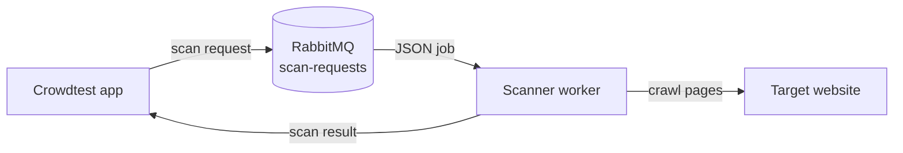
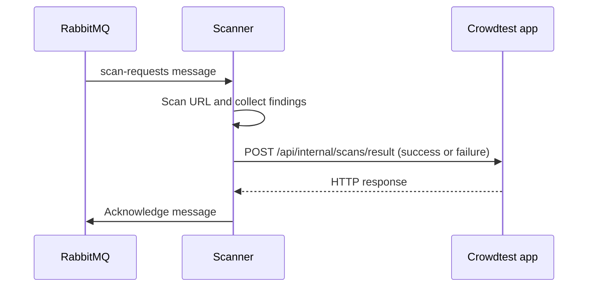

# Crowdtest Scanner

A background worker that scans websites requested by the Crowdtest app. It reads jobs from RabbitMQ and sends scan results back to the app.

## How It Works



1. The app publishes a job to the durable `scan-requests` queue.
2. The scanner reads the job and scans its URL.
3. The scanner POSTs success or failure to the app's result endpoint.

## Run Locally

Requirements: Node.js 22+, a reachable RabbitMQ instance, and the app's result endpoint.

1. Install dependencies:

   ```sh
   npm install
   ```

2. Create a `.env` file in the project root:

   ```dotenv
   RABBITMQ_URL=amqp://localhost
   NEXT_APP_URL=http://localhost:3000
   SCANNER_API_KEY=replace-with-local-api-key
   PORT=8080
   ```

   `NEXT_APP_URL` is the base URL of the app that accepts scan results. The API key must be accepted by that app.

3. Start the worker:

   ```sh
   npm run dev
   ```

4. Check that the HTTP health endpoint responds:

   ```sh
   curl http://localhost:8080/health
   ```

   Expected response: `{"status":"ok","service":"crowdtest-scanner"}`.

The worker connects to RabbitMQ before it starts listening on `PORT` (default `8080`). If RabbitMQ is unavailable or `RABBITMQ_URL` is missing, startup fails.

## Queue Message

Publish a JSON message like this to `scan-requests`:

```json
{
  "eventId": "evt_123",
  "scanId": "scan_456",
  "projectId": "project_789",
  "url": "https://example.com",
  "requestedAt": "2026-10-31T12:00:00.000Z"
}
```

The producer should include all five fields. The scanner uses `scanId`, `projectId`, and `url`; `eventId` and `requestedAt` are part of the message contract.

## Result Flow



Successful scans send `scanId`, `projectId`, `success`, `startedAt`, `pagesScanned`, and `findings` to `POST {NEXT_APP_URL}/api/internal/scans/result`. Failed scans send `scanId`, `projectId`, `success: false`, and an error message. The request uses `Authorization: Bearer {SCANNER_API_KEY}`.

## Build and Deploy

Set a release version, then build and push the image for Azure Container Apps:

```sh
VERSION=v1.0.0
IMAGE=crowdtestscanneremmanuel.azurecr.io/crowdtest-scanner:$VERSION

docker buildx build \
  --platform linux/amd64 \
  --provenance=false \
  -t "$IMAGE" \
  --push .
```

Deploy that same image version:

```sh
az containerapp update \
  --name crowdtest-scanner \
  --resource-group crowdtest-scanner-rg \
  --image "$IMAGE"
```

Configure these values as secrets on the Container App: `rabbitmq-url`, `next-app-url`, and `scanner-secret`. Then map them to the worker's environment variables:

```sh
az containerapp update \
  --name crowdtest-scanner \
  --resource-group crowdtest-scanner-rg \
  --set-env-vars \
    RABBITMQ_URL=secretref:rabbitmq-url \
    NEXT_APP_URL=secretref:next-app-url \
    SCANNER_API_KEY=secretref:scanner-secret
```


## Useful Commands

#### Build + Push
```
- ddocker buildx build \
  --platform linux/amd64 \
  --provenance=false \
  -t crowdtestscanneremmanuel.azurecr.io/crowdtest-scanner:<vx.x.x> \
  --push .
  ```
  
#### Deploy that exact version
```
- az containerapp update \
  --name crowdtest-scanner \
  --resource-group crowdtest-scanner-rg \
  --image crowdtestscanneremmanuel.azurecr.io/crowdtest-scanner:<vx.x.x>
```

  ## Wire env secrets to azure secrets
  ```
  - az containerapp update \
  --name crowdtest-scanner \
  --resource-group crowdtest-scanner-rg \
  --set-env-vars \
    RABBITMQ_URL=secretref:rabbitmq-url \
    NEXT_APP_URL=secretref:next-app-url \
    SCANNER_API_KEY=secretref:scanner-secret
    ```